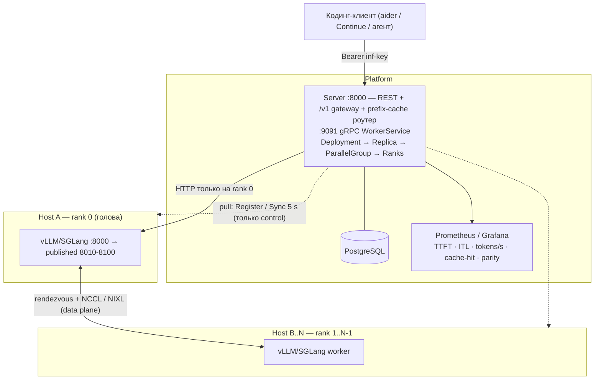
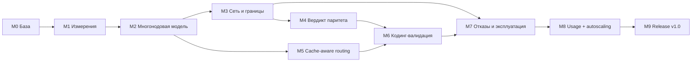

# Направление 7 — Distributed inference: одна модель на нескольких машинах, пригодная для кодинга

Статус: план. Предыдущие направления (gateway, реплики) уже доставляют трафик и репликацию;
это направление добавляет **распределение одной модели по нескольким хостам** и доводит
платформу до конечного продукта: *несколько машин → одна модель размазана → кодинг-ассистент
через единый `/v1`*.

Документ описывает путь **до готового продукта** (не «до следующего релиза»): вехи M0…M9,
гейты выхода, артефакты-доказательства, карту веток и порядок влития.

---

## 0. Конечный продукт: что значит «готово»

Демонстрируемый end-to-end сценарий (он же приёмочный тест всего направления):

1. `bash scripts/dev-setup.sh`; поднимается сервер и **N ≥ 2 GPU-хоста** (в одном DC или
   с netem-эмуляцией WAN; для CI — mock).
2. В UI: кластер → деплой модели → выбор режима распределения (`single | dp | pp | tp | pd`)
   и `nodes_per_replica = N`.
3. Платформа сама: выбирает хосты и GPU, режет модель, поднимает ранги (rank 0 = голова,
   остальные = engine-воркеры), электит rendezvous, отдаёт **единый endpoint** и API-ключ.
4. Кодинг-клиент (aider / Continue / агент на OpenAI SDK) указывает
   `base_url = http://<server>:8000/v1` и работает по модели, физически размазанной по машинам.
5. Сессия кодинга проходит в порогах: `TTFT p95 ≤ 1.0 s`, `ITL ≤ 50 ms` (≥ 20 tok/s),
   `error rate < 0.1 %`, при повторных запросах агентного цикла — попадание в prefix-cache ≥ 80 %.
6. Два артефакта с числами:
   - `docs/multinode-parity.md` — «N машин ≈ 1 машина того же суммарного размера» с измеренными
     коэффициентами и границей применимости по RTT;
   - `docs/coding-validation.md` — прогон фиксированного набора кодинг-задач через `/v1`
     на multi-node конфигурации против single-host baseline.

«Готово» = `scripts/coding-validation.sh` и `scripts/parity.sh` зелёные **на реальном железе**,
и в обоих документах нет ни одной ячейки без измерения.

---

## 1. Где мы сейчас

| Слой | Состояние на сегодня | Точка в коде |
| --- | --- | --- |
| Единица размещения | одна машина: `ModelInstance.worker_id` — единственный FK, `gpu_indexes` — локальные индексы | `server/inferna_server/models.py:201-261` |
| Параллелизм | `tensor_parallel = max(1, len(config.gpu_indexes))`, только внутри хоста | `worker/inferna_worker/engines/base.py:51-65` |
| Контракт воркеру | `EngineConfig{engine, model_name, profile, gpu_indexes, vram_required_mb, port, requires_hf_token}` | `proto/cluster.proto` |
| Планировщик | best-fit по свободной VRAM + anti-affinity реплик; порты 8010–8100 на воркер | `server/inferna_server/services/scheduler.py:134-202` |
| Gateway | выбор одного живого инстанса (least-loaded + LRU) и HTTP на `worker.address:port` | `server/inferna_server/api/gateway.py:382-400, 478-480` |
| Роутинг по кэшу | отсутствует | — |
| Метрики | только TTFB-гистограмма и счётчик токенов; нет TTFT/ITL/TPS | `server/inferna_server/services/metrics.py:31-49` |
| Измерения | нет бенчмарк-харнесса; soak/hardware-smoke мерят только lifecycle | `scripts/soak.sh`, `scripts/hardware-smoke.sh` |
| Топология | в compose ровно один worker, порты не публикуются | `docker-compose.yml:45-59` |
| Сервер | `worker.address` без порта (SSRF-контракт), ни TLS/mTLS | `server/inferna_server/services/upstream_guard.py:29-60` |

Отдельно: ветка `phase2-replicas-autoscaling` (ручные реплики, anti-affinity, least-loaded) готова
к вливанию, но в `main` не влита — это часть M0.

---

## 2. Физика: что вообще возможно

Гипотеза «много машин по сети ничем не хуже одной машины с теми же характеристиками» верна
**не для всех режимов**. Режимы различаются тем, что пересекает сеть на каждый токен:

| Режим | Что пересекает сеть | Инфраструктура | Вердикт |
| --- | --- | --- | --- |
| `dp` — реплики | ничего | любые сети | паритет по throughput; latency = overhead прокси |
| `pp` — слои по машинам | активации на границе стадии: `2·hidden·dtype` ≈ 16 KiB/микробатч, **не зависит от длины контекста** | DC — норм; WAN — только P = 2…3 | throughput паритет при заполненном пайплайне |
| `tp` — тензорный | ~160 allreduce на токен (70B: 80 слоёв × 2), 32 KiB/rank/слой | NVLink / IB / RoCE, RTT 2–5 µs, 400G | только внутри DC-фабрики |
| `pd` — prefill/decode split | KV-кэш: 70B ≈ **320 KiB/токен** (32k контекста ≈ 10.7 GB) | DC, RDMA/NIXL | в DC; для длинного контекста через WAN — нет |

Нижние границы, которыми задаём пороги в гейтах:

$$\text{ITL}_{\text{pp}} \gtrsim \sum_{i=1}^{P-1}\Big(\lambda_i + \tfrac{B \cdot d}{B_{\text{net},i}}\Big)
\qquad
\text{TTFT}_{\text{pp}} \approx \tfrac{\text{prefill}}{P} + (P-1)\lambda$$

Отсюда три сценария применимости (в этом документе они — официальная граница обещаний):

| Сеть | RTT | Что реально пригодно для интерактива |
| --- | --- | --- |
| Одна машина / NVLink | µs | `single`, `tp` внутри хоста |
| DC / стойка | 0.05–0.3 ms | `tp`, `pp`, `pd`, `dp` — **полный паритет достижим** |
| Метро / один регион | 1–5 ms | `pp` (P ≤ 4), `dp` |
| Интернет | 20–60 ms | **только `dp` + cache-aware routing**; `pp` при P = 2 с оговоркой; `tp`/`pd` — нет |

Внешние ориентиры (не наши измерения, использовать как sanity-check): интернет-распределённый
инференс существует (Petals, Helix, BloomBee) и все системы этого класса целятся в **throughput
офлайн-пакетов, а не в latency интерактивной сессии** — BloomBee измеряет 417 KB на стадию, хоп
10.06 ms в DC против 57.91 ms через интернет (56.6 % времени инференса в сети); WANSpec выносит
draft-модель спекулятивного декодинга в свободные регионы. Cache-aware routing для DC уже решён
(llm-d / Gateway API Inference Extension, KV-события из vLLM/SGLang/TRT-LLM).
Вывод: **новые транспортные протоколы для этого не нужны**, нужна платформенная работа
(размещение, rendezvous, измерение, роутинг) плюс честная граница применимости.

---

## 3. Целевая архитектура

Единица размещения расширяется с `(worker, gpu)` до **реплика → параллельная группа → ранги**:



Инварианты (не нарушать ни в одной вехе):

1. Control plane остаётся **pull-based** (worker → server `Sync`), один сервер, без брокеров и очередей.
2. `Worker.address` — без порта; rendezvous-адрес живёт только в `ModelInstance.rendezvous`.
3. Трафик gateway идёт **только на rank 0**.
4. Параллелизм задаётся декларативно (`mode`, `tp`, `pp`, `nodes_per_replica`), команды воркеру —
   по-прежнему `InstanceCommand`; воркер не принимает решений о топологии.
5. `INFERNA_MOCK_ENGINE` обязан поддерживать multi-node, иначе CI и e2e непроверяемы.
6. `parallel_mode = 'single'` работает ровно как сегодня (байт-в-байт по поведению).

---

## 4. Дерево вех



Ключевая идея структуры: **M2 даёт возможность, M1/M3 дают измеримость, M4/M5 дают доказательства
(«не хуже» и «пригодно для кодинга»), M7–M9 доводят до эксплуатации.**

Сводная таблица:

| Веха | Результат | Зависит от | Гейт выхода (наблюдаемо) | Ветки |
| --- | --- | --- | --- | --- |
| M0 | Чистая база и baseline | — | `main` зелёный по всем CI-джобам; в `docs/multinode-bench.md` есть baseline single-host и 2×DP | `chore/merge-phase2` |
| M1 | Слой измерений | M0 | отчёт бенча ±5 % воспроизводим; TTFT/ITL/TPS в `/metrics` и Grafana; overhead прокси измерен | `w1/bench-harness`, `w1/gateway-telemetry` |
| M2 | Одна модель на N хостах | M0 | на mock `nodes_per_replica=2` проходит lifecycle end-to-end; на железе 2×GPU-хоста поднимают multi-node vLLM и отвечают через `/v1` | `w0/multinode-contract`, `w2/server-parallel-groups`, `w2/worker-multinode-runtime` |
| M3 | Сетевая реалистичность | M2 | 3 хоста на одной машине без коллизий; netem-профили применяются; envelope-таблица RTT×BW записана | `w1/network-topology` |
| M4 | Вердикт паритета | M3 | матрица `1×8 / 2×4 / 4×2` × режимы × сети в `docs/multinode-parity.md` с сырыми JSONL; пороги §5 применены | `w3/parity-evidence` |
| M5 | Routing по префикс-кэшу | M1, M2 | повторные промпты агентного цикла ≥ 90 % попадают в ту же реплику; TTFT повторного ≤ 60 % холодного | `w2/cache-aware-routing` |
| M6 | Кодинг-валидация | M4, M5 | `scripts/coding-validation.sh` зелёный на реальном железе; пороги кодинга §5 выполнены; отчёт в `docs/coding-validation.md` | `w3/coding-validation` |
| M7 | Отказоустойчивость и эксплуатация | M6 | fault-матрица пройдена; 24-часовой multi-node soak зелёный; причина падения ранга видна в UI без SSH | `w3/fault-and-soak`, `w3/frontend-parallel`, `w4/diagnostics` |
| M8 | Экономика и упругость | M7 | usage-агрегаты сверяются с gateway-метриками; autoscaling проходит replay реального трейса и масштабирует **целыми параллельными группами** | `w4/usage-metering`, `w4/autoscaling` |
| M9 | Release v1.0 | M8 | TLS/mTLS на gRPC, проверка совместимости версий при Register, заполнена матрица «движок × GPU × категория», upgrade-from-previous-release проходит | `w5/release-hardening` |

---

## 5. Пороги приёмки (единые для M4 и M6)

Паритет «N машин ≈ 1 машина того же суммарного размера» (одинаковое число GPU):

$$R_{tps} = \frac{\text{tokens/s}_{multi}}{\text{tokens/s}_{single}} \ge 0.90
\qquad
R_{p95} = \frac{\text{TTFT}_{p95,multi}}{\text{TTFT}_{p95,single}} \le 1.25$$

Пригодность для кодинга:

| Метрика | Порог |
| --- | --- |
| `TTFT p95` (холодный запрос) | ≤ 1.0 s |
| `TTFT p95` (повтор агентного цикла) | ≤ 0.6 s |
| `ITL` (межтокенная задержка) | ≤ 50 ms |
| Скорость стрима | ≥ 20 tok/s |
| Доля ошибок `/v1` | < 0.1 % |
| Prefix-cache hit на повторных промптах | ≥ 80 % |

Режим, не прошедший пороги на данном RTT, помечается в отчёте как **«непригоден при RTT > X ms»**
с числом X — это результат, а не провал.

---

## 6. Вехи подробно

### M0 — База и baseline

- Влить `phase2-replicas-autoscaling` в `main` (вердикт ревью — PASS; 24 коммита впереди).
- Убрать из корня незакоммиченный мусор ревью (`pr*.diff`, `.pr_files.json`, `REVIEW_REPORT.md`),
  решить судьбу `AGENTS.md`.
- Заморозить baseline-числа текущей системы (single-host, 2 реплики DP) — первым прогоном
  бенча из M1.
- Гейт: все CI-джобы (`backend` matrix, `migrations`, `proto-check`, `openapi-check`, `frontend`, `e2e`)
  зелёные на `main`.
- Риск: без baseline любые последующие коэффициенты бессмысленны — поэтому M1 идёт сразу за M0.

### M1 — Слой измерений

Две независимые ветки.

**`w1/bench-harness`** — инструмент, которым доказывается всё остальное.
- Новый пакет `bench/` (uv, httpx + asyncio) и `scripts/bench.sh`.
- Сценарии: `single` (concurrency sweep 1/4/8/16), `agentic-loop` (повторяющиеся префиксы),
  `long-context` (32k/128k), `ttft-only` (короткий выход).
- Метрики на запрос: TTFT (первый SSE-чанк), ITL, e2e, output tokens/s, p50/p95/p99;
  режим `--mode gateway|direct` (direct — на `instance.port`, чтобы отделить overhead прокси).
- Выход: JSONL + markdown-таблица; `--repeats` и `--warmup` обязательны.
- Гейт: три прогона подряд дают разброс ≤ 5 %; на mock-стеке таблица печатается.

**`w1/gateway-telemetry`** — серверные метрики, чтобы числа жили в Grafana, а не только в JSONL.
- `api/gateway.py` (`_relay`, observe-точки) + `services/metrics.py`:
  `inferna_ttft_seconds`, `inferna_inter_token_seconds`, `inferna_output_tps`
  (labels: `model`, `engine`, `parallelism`), заголовки `X-Inferna-TTFT-Ms`.
- Не ломать существующие `inferna_requests_total` / `inferna_time_to_first_byte_seconds` / `inferna_tokens_total`;
  новые гистограммы не включать в `_ALL_GAUGES`.
- Панели в `deploy/grafana/dashboards/gateway.json`.
- Гейт: unit-тест на моковом SSE-стриме даёт ненулевые значения в `/metrics`.

### M2 — Многонодовая модель (ядро направления)

**Шаг 1 — контракт (`w0/multinode-contract`, самая маленькая ветка, от неё режутся остальные).**

`proto/cluster.proto`:

```proto
message Parallelism { string mode = 1; int32 tensor_parallel = 2;
                      int32 pipeline_parallel = 3; int32 world_size = 4; }
message Rendezvous  { string master_address = 1; int32 master_port = 2; int64 job_id = 3;
                      int32 node_rank = 4; int32 num_nodes = 5; repeated string peers = 6; }
message EngineConfig { /* 1..7 без изменений */
                       Parallelism parallelism = 8; Rendezvous rendezvous = 9; repeated string env = 10; }
```

БД (одна ревизия от текущего head `b4d7e91c2a58`):
`ModelInstance` += `parallel_group_id`, `node_rank`, `world_size`, `parallel_mode`, `rendezvous`;
уникальный индекс `(parallel_group_id, node_rank)`; `Deployment` += `nodes_per_replica`, `parallel_mode`.
Конфиг: `INFERNA_RENDEZVOUS_PORT_RANGE_START/END` в `server/config.py` и `.env.example`.

Гейт: `bash scripts/gen-proto.sh && git diff --exit-code`, `bash scripts/check-migrations.sh`,
`ruff`/`pyright`/`pytest`/`export-openapi.py --check`; поведение `single` не изменилось.

**Шаг 2 — две ветки параллельно от tip `w0`.**

`w2/server-parallel-groups`:
- новый `allocate_parallel_replicas` в `services/scheduler.py`: на реплику — N хостов (anti-affinity),
  N портов, rendezvous-порт из нового диапазона, election rank 0 (хост с валидным `address`);
- `api/instances.py`, `api/deployments.py`, `schemas.py`: `nodes_per_replica`, `parallel_mode`;
- `services/workers_svc.py`: сборка `EngineConfig.parallelism/rendezvous` по рангам;
- `services/scaling.py`: масштабирование **целыми группами**, не отдельными рангами;
- `docs/openapi.yaml` регенерируется в этой же ветке;
- порядок блокировок не менять (`deployment → workers`), опираться на существующие `FOR UPDATE` и
  частичный уникальный индекс `(worker_id, port)`.

`w2/worker-multinode-runtime`:
- `engines/base.py`: `mode=pp/tp` → vLLM `--nnodes/--node-rank/--master-addr/--master-port`
  (+ backend) / SGLang `--nnodes/--node-rank/--dist-init-addr`; точный argv закрепляется тестами;
- `engines/manager.py`: env из `Rendezvous.env` (`MASTER_ADDR/MASTER_PORT/VLLM_HOST_IP/NCCL_SOCKET_IFNAME/NCCL_*`),
  сетевая доступность rendezvous-порта (публикация порта/host-сеть — решение фиксируется тут и в M3),
  готовность: rank 0 — health-probe `/v1/models`, rank > 0 — «контейнер жив» + лог-хвост,
  корректный порядок остановки, чтобы не подвешивать голову;
- `config.py`, `Dockerfile`; mock-движок эмулирует multi-node (все ранги `running` после задержки).

Гейт M2: mock e2e `deploy(nodes=2) → running → stop → delete`; на железе 2 хоста поднимают
multi-node vLLM и отвечают через `/v1`; gateway никогда не отправляет трафик на rank ≠ 0.

### M3 — Сеть и границы применимости

`w1/network-topology` (можно начинать сразу, зависимостей по коду нет):
- `docker-compose.multinode.yml` — 3 воркера на одной машине с разными `INFERNA_WORKER_ADDRESS`,
  разными `INFERNA_MODELS_DIR` и публикацией портов;
- `scripts/netem.sh` — профили `dc-0.1ms`, `dc-2ms`, `wan-25ms-1%` (tc netem) между воркерами;
- `scripts/wan-envelope.sh` — iperf3 + точечные замеры «RTT × доступная полоса → достижимый обмен
  на стадию/на токен»;
- `docs/network-matrix.md` — порт-матрица и что открывать на файрволе:
  control `9091`, instance `8010–8100`, rendezvous `8110–8199`, NCCL/ephemeral `20000–20100`,
  NIXL `56000–56100` (уточняется здесь и далее считается контрактом).

Гейт: 3 воркера регистрируются одновременно без коллизий портов; netem проверяемо меняет RTT
(замер `ping`/iperf3 приложен); envelope-таблица записана.

### M4 — Вердикт паритета

`w3/parity-evidence`:
- `scripts/parity.sh`: поднять конфигурации `1×8 GPU` (baseline), `2×4`, `4×2`; для каждой —
  режимы `single | dp | pp | tp` (и `pd` как эксперимент) × сетевые профили M3;
- на ячейку — прогон `bench` и запись: `TTFT p50/p95`, `ITL`, `tokens/s @conc`, коэффициент к
  baseline, вердикт по порогам §5;
- `docs/multinode-parity.md` — итоговый отчёт + раздел «граница применимости» (X в «непригоден при RTT > X ms»);
- обновление `docs/architecture.md` (раздел Multi-node) и `docs/roadmap/README.md`.

Гейт: одна команда воспроизводит весь отчёт; ни одной ячейки без измерения; mock-числа явно помечены.

### M5 — Cache-aware routing (главный рычаг для кодинга)

`w2/cache-aware-routing` (владеет функцией выбора инстанса в `api/gateway.py`; сюда же входит
фильтр `node_rank == 0`):
- новый `services/prefix_cache.py`: нормализация префикса промпта, rolling-hash блоков (~128 токенов),
  карта «резидентные префиксы по инстансам» из ответов движка (счётчики prefix-cache hit) и KV-событий;
- скоринг: максимум совпавшего префикса → tie-break существующим least-loaded + LRU
  (инвариант «нет await внутри `_active_lock`» сохранить);
- метрика `inferna_prefix_cache_hit_ratio{model}`;
- fallback: при недоступности «горячей» реплики — обычный least-loaded, без деградации.

Гейт: на 2 репликах повторные промпты агентного цикла в ≥ 90 % случаев идут в ту же реплику;
TTFT повторного ≤ 60 % холодного; при убийстве реплики поведение не хуже текущего.

### M6 — Кодинг-валидация (проверка конечной цели)

`w3/coding-validation`:
- `scripts/coding-validation.sh` + фикс-набор задач на тестовом репозитории (генерация функции,
  починка падающего теста, рефакторинг, правка по тексту ошибки) — 10–15 задач;
- клиент: реальный кодинг-инструмент через `/v1` (aider/Continue) **и** агентный loop на OpenAI SDK
  как минимальный воспроизводимый вариант;
- запись на задачу: TTFT, ITL, tok/s, число tool-итераций, успех/провал, prefix-cache hit;
- `docs/coding-validation.md`: multi-node vs single-host baseline на одинаковой модели и одинаковом
  числе GPU; вывод «пригодно/непригодно» по порогам §5.

Гейт: сценарий проходит на реальном железе; отчёт содержит сырые JSONL; регресс порогов ловится
повторным прогоном в CI (mock) и по расписанию (hardware).

### M7 — Отказы и эксплуатация

- `w3/fault-and-soak`: сценарии — убийство rank 0 mid-stream, потеря пира rank 1→2, рестарт воркера
  с живым контейнером, netem loss 5 % mid-generation, рестарт сервера во время деплоя; ожидания —
  предсказуемая ошибка клиенту, остальные реплики живы, осиротевших контейнеров нет.
  `scripts/soak-multinode.sh` — 24 часа с рандомизированными сбоями.
- `w4/diagnostics` (направление 04-instance-logs): per-rank логи и события lifecycle в UI
  (новый gRPC-метод получения логов — ветка получает владение `proto/cluster.proto` после влития `w0`);
  `/readyz` учитывает состояние БД, миграций и gRPC.
- `w3/frontend-parallel`: в `/instances` группа отображает узлы/ранги/rendezvous; Endpoint-модал
  только у головы; деплой-диалог получает `nodes per replica` и режим; e2e на mock.

Гейт: fault-матрица пройдена и записана; soak 24 ч зелёный; причина падения ранга видна в UI без SSH.

### M8 — Экономика и упругость

- `w4/usage-metering` (направление 05): `UsageRecord`, агрегация per ключ/пользователь/модель,
  сверка с gateway-метриками, quotas.
- `w4/autoscaling` (Release B направления 02): политика на измеренной нагрузке (TTFT/ITL/длина очереди),
  cooldown, replay записанного трейса; масштабирование **только целыми параллельными группами**
  (инвариант M2: отдельный ранг — не единица масштабирования).

Гейт: агрегаты сверяются с `inferna_requests_total`/`inferna_tokens_total`; политика проходит replay
и не создаёт осцилляций; scale-out не оставляет «половин» групп.

### M9 — Release v1.0

- TLS/mTLS на gRPC (`9091`) либо задокументированная приватная граница с явным чек-листом;
- release-версионирование server/worker/`PROTOCOL_VERSION` + проверка совместимости при `Register`;
- заполненная матрица `docs/engine-matrix.md` (движок × vendor × категория) по результатам
  `scripts/hardware-smoke.sh` на реальном железе;
- все `Observed:` в `docs/phase0-validation.md` заполнены;
- upgrade-from-previous-release в `scripts/check-migrations.sh` (`PREVIOUS_RELEASE_HEAD`);
- тег `v1.0`, changelog, обновлённый `README.md`, финальный прогон всех CI-гейтов.

Гейт: чек-лист релиза пройден; `docs/multinode-parity.md` и `docs/coding-validation.md` воспроизводимы
на чистом стенде по инструкции из README.

---

## 7. Карта веток

Правило параллелизма: **контракт (`proto/cluster.proto` + схема БД) замораживается в M2-шаге 1,
дальше его никто не меняет, кроме явного владельца** (M7 — добавление RPC логов). Остальные ветки
владеют disjoint-набором файлов; стабы proto генерируются детерминированно, поэтому вливается
второй — перегенеряет.

| Ветка | Веха | Владеет файлами | Зависит от |
| --- | --- | --- | --- |
| `chore/merge-phase2` | M0 | `main`, `.gitignore` | — |
| `w0/multinode-contract` | M2.1 | `proto/cluster.proto`, `*_pb2*.py`, `models.py`, `alembic/versions/`, `server/config.py`, `.env.example` | M0 |
| `w1/bench-harness` | M1 | `bench/`, `scripts/bench.sh`, `docs/multinode-bench.md` | M0 |
| `w1/gateway-telemetry` | M1 | `api/gateway.py` (relay+observe), `services/metrics.py`, `deploy/grafana/*` | M0 |
| `w1/network-topology` | M3 | `docker-compose.multinode.yml`, `scripts/netem.sh`, `scripts/wan-envelope.sh`, `docs/network-matrix.md` | M0 |
| `w2/server-parallel-groups` | M2.2 | `services/scheduler.py`, `services/scaling.py`, `services/workers_svc.py`, `api/instances.py`, `api/deployments.py`, `schemas.py`, `docs/openapi.yaml` | `w0` |
| `w2/worker-multinode-runtime` | M2.2 | `worker/inferna_worker/**` | `w0` |
| `w2/cache-aware-routing` | M5 | `api/gateway.py` (выбор инстанса), `services/prefix_cache.py`, `services/metrics.py` (одна метрика) | M1, `w0` |
| `w3/parity-evidence` | M4 | `scripts/parity.sh`, `docs/multinode-parity.md`, `docs/architecture.md`, `docs/roadmap/README.md` | M2, M3, M1 |
| `w3/coding-validation` | M6 | `scripts/coding-validation.sh`, `coding/`, `docs/coding-validation.md` | M4, M5 |
| `w3/fault-and-soak` | M7 | `scripts/soak-multinode.sh`, fault-тесты | M2, M3 |
| `w3/frontend-parallel` | M7 | `frontend/**` | `w0`, `w2/server-parallel-groups` |
| `w4/diagnostics` | M7 | `api/diagnostics.py`, `services/logs.py`, `proto/cluster.proto` (RPC логов), `grpc_server.py` | M6 |
| `w4/usage-metering` | M8 | `models.py` (UsageRecord, новая ревизия), `services/usage.py`, `api/usage.py`, UI-страница | M7 |
| `w4/autoscaling` | M8 | `services/autoscaling.py`, `services/scaling.py`, `main.py` (фоновый цикл) | M8-metering |
| `w5/release-hardening` | M9 | `config.py`, `grpc_server.py`, `services/workers_svc.py`, `version.py` (оба пакета), `scripts/check-migrations.sh`, `README.md`, changelog | M8 |

Порядок влития по волнам:

1. **Волна A** (можно запускать сразу): `chore/merge-phase2`, `w1/bench-harness`,
   `w1/gateway-telemetry`, `w1/network-topology`.
2. **Волна B**: `w0/multinode-contract` → от её tip: `w2/server-parallel-groups`,
   `w2/worker-multinode-runtime`, `w2/cache-aware-routing`.
3. **Волна C**: `w3/parity-evidence`, `w3/coding-validation`, `w3/fault-and-soak`, `w3/frontend-parallel`.
4. **Волна D**: `w4/diagnostics`, `w4/usage-metering` → затем `w4/autoscaling`.
5. **Волна E**: `w5/release-hardening` → тег `v1.0`.

Точки контеншна и их арбитраж:

- `api/gateway.py`: `w1/gateway-telemetry` → `w2/cache-aware-routing` (строго в этом порядке);
- `services/metrics.py`: то же правило;
- `models.py` / `alembic/versions/`: только `w0`, затем `w4/usage-metering` (ревизия поверх head);
- `services/scaling.py`: `w2/server-parallel-groups`, затем `w4/autoscaling`;
- `proto/cluster.proto`: `w0`, затем `w4/diagnostics`.

---

## 8. Что сознательно не делаем

- Kubernetes/operator, Redis/очереди, второй сервис, HA/leader election — вне scope `PRODUCT_SPEC.md`.
- CLI/SDK, billing, llama.cpp.
- Обещание «одна модель через интернет с интерактивной latency»: публикуем измеренную границу, а не фичу.
- Квалификация AMD до зелёного NVIDIA-пути.
- Разрезание одной реплики между машинами, соединёнными только WAN, для режимов `tp`/`pd`.

---

## 9. Приложения

### 9.1 Порт-матрица (контракт после M3)

| Диапазон/порт | Назначение | Кто открывает |
| --- | --- | --- |
| `8000` | REST API + `/v1` gateway | наружу через reverse-proxy с TLS |
| `9091` | gRPC control (Register/Sync) | только с worker-хостов |
| `8010–8100` | instance-порты (rank 0 публикует API) | только server → worker |
| `8110–8199` | rendezvous master-порт параллельной группы | все ранги группы между собой |
| `20000–20100` | NCCL/ephemeral | ранги между собой |
| `56000–56100` | NIXL (при `pd`) | ранги между собой |
| `5432`, `9090`, `3000` | Postgres, Prometheus, Grafana | внутренняя сеть |

### 9.2 Метрики (после M1/M5)

| Метрика | Тип | Labels |
| --- | --- | --- |
| `inferna_ttft_seconds` | histogram | `model`, `engine`, `parallelism` |
| `inferna_inter_token_seconds` | histogram | `model`, `engine`, `parallelism` |
| `inferna_output_tps` | histogram | `model`, `engine`, `parallelism` |
| `inferna_prefix_cache_hit_ratio` | gauge | `model` |
| `inferna_requests_total`, `inferna_tokens_total`, `inferna_instance_active_requests` | существующие | без изменений |

### 9.3 Глоссарий

- **Реплика** — один обслуживающий экземпляр модели; при multi-node реплика состоит из рангов.
- **Параллельная группа (parallel group)** — набор рангов одной реплики, `world_size` = число рангов.
- **rank 0 / голова** — ранг, публикующий OpenAI API; единственная цель gateway.
- **rendezvous** — адрес и порт, по которым ранги находят друг друга; создать может только rank 0.
- **`dp`** — реплики без обмена тензорами (data parallel по факту обслуживания).
- **`pp`** — слои модели разложены по рангам; между рангами ходят только активации.
- **`tp`** — тензоры слоя разложены по рангам; требует allreduce на каждом слое.
- **`pd`** — фазы prefill и decode разнесены по разным рангам, между ними передаётся KV-кэш.
- **Envelope** — таблица «RTT × полоса → пригодный режим», результат M3/M4.