# Программа: остаток роадмапа (04 → 03 → 05 → 06 → autoscaling)

Слаг: `roadmap-program-03-06`. Роль: программный план-скелет. Он НЕ заменяет
`docs/roadmap/*.md` (они — источник требований и порогов) и НЕ дублирует шаги: исполняемые шаги
живут в пяти планах направлений (ссылки в §5). Здесь — только последовательность, зависимости,
точки контеншена, гейты и определение «готово».

Рабочая директория: `C:/Users/admin/Desktop/projects/inferna-next`.
Ветка на старте: `phase2-replicas-autoscaling` (head `65e1f3c`).

## 1. База: что уже доставлено (проверено по коду, не по докам)

| Направление | Статус | Доказательство |
|---|---|---|
| Этап 0 production readiness | доставлено | `server/alembic/versions/d88ae166a92a_phase0_production_readiness.py` |
| Этап 1 gateway (`01`) | доставлено | `server/inferna_server/api/gateway.py`, `alembic/d18580a27109_phase1_gateway.py`, `server/tests/test_gateway*.py` |
| Этап 4 реплики, Release A (`02`) | доставлено, **не влито в `main`** | `alembic/e8f2a6c41d93_phase2_replicas.py`, `services/scaling.py`, ветка `phase2-replicas-autoscaling` |
| Этап 2 диагностика (`04`) | не начато | `proto/cluster.proto:43-49` `InstanceStatus` без `log_tail`; нет `api/diagnostics.py` |
| Этап 3 custom models (`03`) | не начато | `api/models.py` — только `GET ""`, `GET /{id}` |
| Этап 5 usage (`05`) | не начато | нет `UsageRecord` в `models.py`, нет `api/usage.py` |
| Этап 6 autoscaling (`02` Release B) | не начато | нет `services/autoscaling.py`; только комментарии-заготовки `services/scaling.py:21,37` |
| Этап 7 distributed (`06`) | не начато | `EngineConfig` = 7 полей (`proto/cluster.proto:51-59`); `engines/base.py:51` — one-host |

Следствие: «03–06» из запроса неполон как множество. Autoscaling (этап 6) не реализован, а `06` M8
на него опирается («масштабирование только целыми параллельными группами»). Поэтому в программе
он есть — как отдельный план `plan-02-release-b-autoscaling.md`, исполняемый после `06` M2.2.

## 2. Порядок (выбран: независимые ветки первыми)

Причина: гейты `06` M2/M4/M6/M9 требуют реальных GPU-хостов, а 04/03/05 их не требуют и не трогают
proto-контракт `06`. Сначала даём диагностируемость и метрики, затем строим multi-node.

```mermaid
graph LR
  W0["Волна 0<br/>merge phase2, чистка корня"] --> W1["Волна A<br/>04 → 03 → 05<br/>последовательно, один писатель alembic"]
  W1 --> W2["Волна B<br/>06 M1: bench + gateway telemetry, M0 baseline"]
  W2 --> W3["Волна C<br/>06 M2.1 contract<br/>единственный писатель proto+alembic"]
  W3 --> W4["Волна D<br/>06 M2.2 groups+runtime, M3 network-topology"]
  W4 --> W5["Волна E<br/>06 M4 parity, M5 cache routing<br/>02 Release B autoscaling"]
  W5 --> W6["Волна F<br/>06 M6 coding-validation"]
  W6 --> W7["Волна G<br/>06 M7 fault/soak/diagnostics/frontend<br/>05 quotas"]
  W7 --> W8["Волна H<br/>06 M8 autoscaling целыми группами, M9 release v1.0"]
```



| Волна | Содержимое | Ветки | Гейт волны | План шагов |
|---|---|---|---|---|
| 0 | merge `phase2` → `main`, чистка корня, `artifacts/` в `.gitignore` | `chore/merge-phase2` | все CI-джобы зелёные на `main` (README этап 0) | `roadmap-program-03-06.md` §4.1 |
| A | instance logs → custom models → usage metering | `p04-instance-logs`, `p03-custom-models`, `p05-usage-metering` | приёмки `04` + `03` + `05` (§3), `gen-proto`/`openapi`/`migrations` чисто | `plan-04-instance-logs.md`, `plan-03-custom-models.md`, `plan-05-usage-metering.md` |
| B | bench-харнесс + gateway telemetry + baseline | `w1/bench-harness`, `w1/gateway-telemetry` | `06` M1 гейт: разброс ±5 %, TTFT/ITL/TPS в `/metrics` и Grafana, baseline в `docs/multinode-bench.md` | `plan-06-distributed-inference.md` §M0/M1 |
| C | контракт multi-node (единственный писатель proto/alembic) | `w0/multinode-contract` | `gen-proto.sh && git diff --exit-code`, `check-migrations.sh`, поведение `single` байт-в-байт | `plan-06-distributed-inference.md` §M2.1 |
| D | параллельные группы на сервере, runtime воркера, сетевая топология | `w2/server-parallel-groups`, `w2/worker-multinode-runtime`, `w1/network-topology` | `06` M2 гейт (mock lifecycle + железо) и M3 гейт (3 воркера, netem, envelope) | `plan-06-distributed-inference.md` §M2.2/§M3 |
| E | вердикт паритета, routing по префикс-кэшу, autoscaling | `w3/parity-evidence`, `w2/cache-aware-routing`, `p02b-autoscaling` | `06` M4/M5 гейты; приёмка `02` Release B (§3) | `plan-06...` §M4/§M5, `plan-02-release-b-autoscaling.md` |
| F | кодинг-валидация | `w3/coding-validation` | `06` M6 гейт: `scripts/coding-validation.sh` зелёный на железе, пороги §5 | `plan-06...` §M6 |
| G | отказы/soak, диагностика рангов в UI | `w3/fault-and-soak`, `w4/diagnostics`, `w3/frontend-parallel` | `06` M7 гейт | `plan-06-distributed-inference.md` §M7 |
| H | usage-агрегаты vs gateway-метрики, autoscaling группами, релиз | `w4/usage-metering`, `w4/autoscaling`, `w5/release-hardening` | `06` M8/M9 гейты; `06` §0: `parity.sh` и `coding-validation.sh` зелёные на железе, нет пустых ячеек | `plan-06...` §M8/§M9 |

Внутри волны A порядок жёсткий: **04 → 03 → 05**. Причина: 04 и 05 оба пишут `models.py` +
`alembic/versions/`; 03 зависит от диагностики (README: этап 3 требует этап 2) и трогает те же
`schemas.py`/фронт-каталог, что 05 (новая страница + навигация). Внутри волн B–H параллелизм
разрешён только при непересекающихся файлах (§4.2).

## 3. Гейты направлений (из их acceptance criteria, дословно по смыслу)

- `04`: instance в `error` показывает причину в UI без SSH; логи обновляются на переходе
  `starting → running`; mock-режим синтезирует логи как остальное своё состояние.
- `03`: произвольный HF-репозиторий деплоится без правок кода; модель в каталоге помечена как
  custom; deploy/stop ведут себя как у builtin.
- `05`: после gateway-запросов видна статистика per-user/model/day; данные сверяются с Prometheus
  (стримы без usage-чанка считаются по факту запроса). Квоты — вторая половина, мягкие лимиты.
- `02` Release B: политика по измеренной нагрузке (queue/latency/TPS) с cooldown проходит replay
  реального трейса и не создаёт осцилляций; scale-out не оставляет «половин» групп.
- `06`: M0–M9 по `docs/roadmap/06-distributed-inference.md` §6, пороги §5, конечный продукт §0.

## 4. Правила исполнения

### 4.1 Волна 0 (делается первым и один раз)

Фактический `git status --short` на 2026-10-13 (проверено в этой сессии):

```
 M docs/roadmap/02-replicas-autoscaling.md
 M docs/roadmap/README.md
?? .pr_files.json          ?? AGENTS.md               ?? DISTRIBUTED_INFERENCE_PLAN.md
?? REVIEW_REPORT.md        ?? docs/roadmap/06-distributed-inference.md
?? pr2.diff                ?? pr2_group4.diff         ?? pr_group5.diff
```

1. Влить `phase2-replicas-autoscaling` в `main`; конфликт-резолв — по `main` как источнику правды.
2. **Закоммитить доки роадмапа** — `docs/roadmap/06-distributed-inference.md` и правки
   `docs/roadmap/02-replicas-autoscaling.md`, `docs/roadmap/README.md` сейчас незакоммичены, а
   они — источник требований для всех пяти планов. Коммит до любой реализации.
3. Убрать мусор ревью: `pr2.diff`, `pr2_group4.diff`, `pr_group5.diff` (три копии одного дифа,
   175.4 KB / 4382 строки каждая), `.pr_files.json`, `REVIEW_REPORT.md`,
   `DISTRIBUTED_INFERENCE_PLAN.md` (дубль отклонённого `multi-node-mvp-plan.md`, сохранённый
   закрытым planning-агентом). `AGENTS.md` — решить судьбу: репо-правила нужны, поэтому
   закоммитить (удалив из него процесс ревью, если он там описан), а не удалять.
4. Добавить `artifacts/` в `.gitignore` — прогонные JSONL (`parity-*.jsonl`, `bench-out/`,
   `soak-*.jsonl`) не коммитятся, но и не мусорят `git status` (требование «чистый корень» §M0).
5. Гейт: `bash scripts/gen-proto.sh && git diff --exit-code`, `cd server && uv run python
   ../scripts/export-openapi.py --check`, `bash scripts/check-migrations.sh`, ruff/pyright/pytest
   (server+worker), `npm run lint`/`npx tsc --noEmit`/`npx vitest run` — всё на `main`.

### 4.2 Один писатель на файл

- `proto/cluster.proto` + `*_pb2*.py`: волна A (`04`, поле `log_tail`) → волна C (`w0`, contract) →
  волна G (`w4/diagnostics`, RPC логов). Три разных момента, никогда одновременно.
- `server/inferna_server/models.py` + `alembic/versions/`: волна A `04` (`log_tail`-хранение) →
  волна A `05` (`UsageRecord`) → волна C `w0` (колонки параллельной группы) → волна G
  `w4/usage-metering` (агрегаты/квоты). Ревизии строго друг над другом, head сверять перед каждой.
- `server/inferna_server/api/gateway.py`: `05` (запись usage-события) → `w1/gateway-telemetry`
  (observe-точки `_relay`) → `w2/server-parallel-groups` (**только** ранг-фильтр `node_rank == 0`:
  без него не закрыть гейт M2) → `w2/cache-aware-routing` (скоринг по префиксу; ранг-фильтр
  остаётся первым условием). Это отклонение от §7 роадмапа (там выбор инстанса целиком у M5) —
  осознанное и минимальное, зафиксировано в `plan-06-distributed-inference.md` §0.2/M2.2.
  `05` может писать событие в одной функции рядом с `_record_usage`, телеметрия добавляет
  гистограммы — порядок обязателен, обратный даст конфликт в `_relay`.
- `server/inferna_server/services/scaling.py`: `w2/server-parallel-groups` → `p02b-autoscaling`
  → `w4/autoscaling`. Autoscaling не начинает, пока группы не влиты: иначе политику придётся
  переписывать под группы.
- `services/scheduler.py`: `w2/server-parallel-groups` единолично; autoscaling и `w4` его не трогают
  (используют публичные функции).

### 4.2.1 Перед каждым коммитом — проверить ветку

`git branch --show-current` перед `git commit`: фоновые job'ы (`--watch` + merge) могут переключить
рабочее дерево на `main`, и коммит уезжает не в ту ветку (за сессию это случилось трижды, каждый раз
лечилось `git branch -f <ветка> <commit>` + `reset --hard origin/main`). Ветку создавать явно **до**
правок (`git switch -c <ветка> main`), а не «на текущей».

### 4.3 Общие барьеры (для всех планов)

- Новые env-переменные: префикс `INFERNA_`, задокументировать в `.env.example` и обоих
  `config.py`, если переменная общая (AGENTS.md).
- Логи — только `structlog`; тесты — pytest `asyncio_mode=auto`, docstring в начале файла,
  хелперы с `_`; фронт — React Query через `src/api/hooks.ts`, никакого `fetch` вне `client.ts`.
- После правок proto — `bash scripts/gen-proto.sh` и commit стабов; после правок REST-схем —
  `export-openapi.py` и commit `docs/openapi.yaml`.
- Ни один план не расширяет объём «пока мы здесь»: `docs/roadmap/06` §8 и README «Что сознательно
  не делать» — жёсткая граница (нет k8s, очередей, Redis, billing, второго сервиса, CLI/SDK).

### 4.4 Железо

Гейты, которые НЕ закрываются mock-стендом и требуют ≥2 реальных GPU-хостов: `06` M2 (железо-часть),
M3 (netem-профили и envelope можно частично на одной машине, но «3 хоста» — по M3-гейту), M4, M6,
M9. Если хостов нет — в evidence плана пишется `BLOCKED: no two-GPU-host environment available`,
и волна идёт дальше по mock-гейтам, а не останавливается.

## 5. Планы направлений

| Файл | Что покрывает | Ветки |
|---|---|---|
| `plan-04-instance-logs.md` | Этап 2 README: `log_tail` в proto → воркер → API → UI-панель | `p04-instance-logs` |
| `plan-03-custom-models.md` | Этап 3: `POST /api/v1/models`, форма, защита от коллизии с builtin | `p03-custom-models` |
| `plan-05-usage-metering.md` | Этап 5: `UsageRecord`, событие из gateway, агрегатор, `/api/v1/usage`, страница, Grafana, квоты | `p05-usage-metering` |
| `plan-02-release-b-autoscaling.md` | Этап 6: политика по метрикам, cooldown, replay, целые группы | `p02b-autoscaling` |
| `plan-06-distributed-inference.md` | Этап 7 целиком: M0–M9, 16 веток, 5 волн | `w0`…`w5` (имена по `06` §7) |

`multi-node-mvp-plan.md` — **superseded** планом `plan-06-distributed-inference.md`. Сохранить как
историю, не исполнять. Дельта, из-за которой он заменён: (1) отсутствовал `w0/multinode-contract`,
без которого multi-node поля не доходят до воркера; (2) rendezvous в `error_detail` стирается
`workers_svc.py:219` на первом же Sync и ломает инвариант «трафик только на rank 0»;
(3) пользовательские `node_ids/master_host/master_port` вместо выборов платформы и порт-матрицы
`8110–8199`; (4) bench жил в `server/bench/` вместо корневого `bench/` (ownership `06` §7);
(5) mock-OpenAI-сервер и `INFERNA_MOCK_OPENAI_PORT` — объём вне гейта M2 и источник коллизий портов;
(6) «кодинг-валидация» в заголовке при отсутствии M6-дельiverable.

## 6. Evidence Artifacts

- По каждому плану направления — свой файл `evidence-<slug>.md` в `docs/roadmap/plans/`
  (коммитится вместе с планом; в session-`local/` дубликаты не нужны):
  шаг → фактическая команда → сокращённый вывод → результат → дата. Дополнительные файлы
  наблюдений не создаются.
- Прогонные артефакты (`artifacts/**/*.jsonl`, `bench-out/`) — в рабочей директории, git-ignored
  (волна 0, §4.1.3), в планах на них ссылаются как на источник чисел для отчётов `06` M4/M6.
- Отчёты, которые роадмап требует коммитить (`docs/multinode-bench.md`, `docs/multinode-parity.md`,
  `docs/coding-validation.md`, `docs/network-matrix.md`, обновления `docs/architecture.md` и
  `docs/roadmap/README.md`) — коммитятся в соответствующих ветках плана `06`, не в evidence-файл.

## 7. Определение «программа закрыта»

1. README-этапы 2, 3, 5, 6: приёмки из §3 выполнены, ветки влиты в `main`.
2. `06` §0: `scripts/parity.sh` и `scripts/coding-validation.sh` зелёные **на реальном железе**;
   `docs/multinode-parity.md` и `docs/coding-validation.md` без пустых ячеек.
3. `06` §5 пороги применены к измеренным числам (TTFT p95 ≤ 1.0 s холодный / ≤ 0.6 s повтор,
   ITL ≤ 50 ms, ≥ 20 tok/s, ошибки < 0.1 %, prefix-cache hit ≥ 80 %, `R_tps ≥ 0.90`,
   `R_p95 ≤ 1.25`), режимы вне порога помечены «непригоден при RTT > X ms».
4. M9: тег `v1.0`, TLS/mTLS на gRPC, версионирование + проверка совместимости при `Register`,
   `docs/engine-matrix.md` и `docs/phase0-validation.md` заполнены по hardware-smoke,
   upgrade-from-previous-release проходит.

## 8. Фактическое исполнение (обновлено 16 октября 2026)

| Волна | PR | Что влито | Evidence |
|---|---|---|---|
| 0 | #4, #5 | гигиена репо, доки роадмапа, планы в репо, презентация GitHub | §4.1 |
| A | #22, #24, #25 (+#26) | 04 логи инстансов, 03 custom models, 05 usage + квоты | `evidence-p04-*`, `evidence-p03-*`, `evidence-p05-*` |
| B | #27, #28 | bench-харнесс и телеметрия gateway (TTFT/ITL/TPS + Grafana) | `docs/multinode-bench.md`, `evidence-06-m1-telemetry.md` |
| C | #30, #31, #32, #33 | контракт `w0`, серверные группы, worker runtime, сеть/порты | `evidence-w0-*`, `evidence-w2-server-*`, `evidence-w2-worker-*`, `docs/network-matrix.md` |
| D | #34, #35 | вердикт паритета, маршрутизация по префикс-кэшу | `docs/multinode-parity.md`, `evidence-w2-cache-aware-routing.md` |
| E | #36 | кодинг-валидация (12 задач, opt-in pytest, CI-харнесс) | `docs/coding-validation.md` |
| F | #37, #38, #39 | диагностика рангов (`?live=true`), UI параллельных групп, fault-матрица + soak | `evidence-w4-diagnostics.md`, `evidence-w3-frontend-parallel.md`, `docs/fault-matrix.md` |
| G | #40, #42 | autoscaling (окно + политика + целые группы), usage-reconcile как CI-гейт | `evidence-p02b-autoscaling.md`, `evidence-p05-*` (§M8) |
| H | #41 | gRPC TLS/mTLS, тесты версионного гейта, `CHANGELOG.md` | `evidence-w5-release-hardening.md` |

Отличия от исходной раскладки §1: autoscaling (`plan-02`) исполнен в волне G, а не E — политике нужны
измерения M1 и целые группы из M2.2; M5 переехал в волну D (после M4), M6 — в E, `w4/diagnostics` —
в F. Порядок «независимые направления первыми» (04 → 03 → 05) соблюдён, как и правило одного писателя
на файл.

Отклонения, зафиксированные явно (каждое с обоснованием в своём evidence): нет `rpc GetLogs`
(server→worker) — противоречит pull-модели и порт-матрице; autoscaling читает TTFT/очередь вместо
proxy-метрик; throughput не публикуется для coalesced-стримов; `/readyz` уже покрывал БД/миграции/gRPC
и не переписывался.

Осталось до 1.0 (всё — железо, не код): engine-matrix и phase0-validation по `hardware-smoke.sh`,
прогоны parity/coding на железе, 24-часовой soak с инъекцией сбоев (`--docker`), затем bump версий,
`PREVIOUS_RELEASE_HEAD` и тег `v1.0`. Команды — `docs/multinode-parity.md`,
`docs/coding-validation.md`, `docs/fault-matrix.md` §Status.
